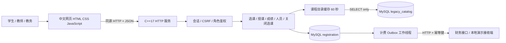
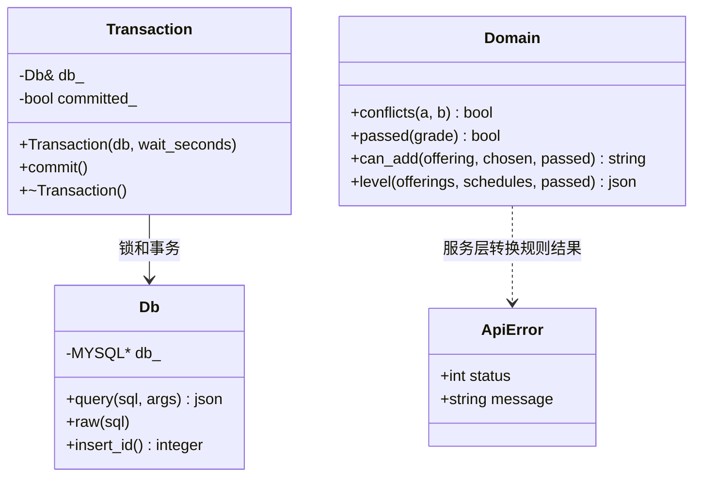
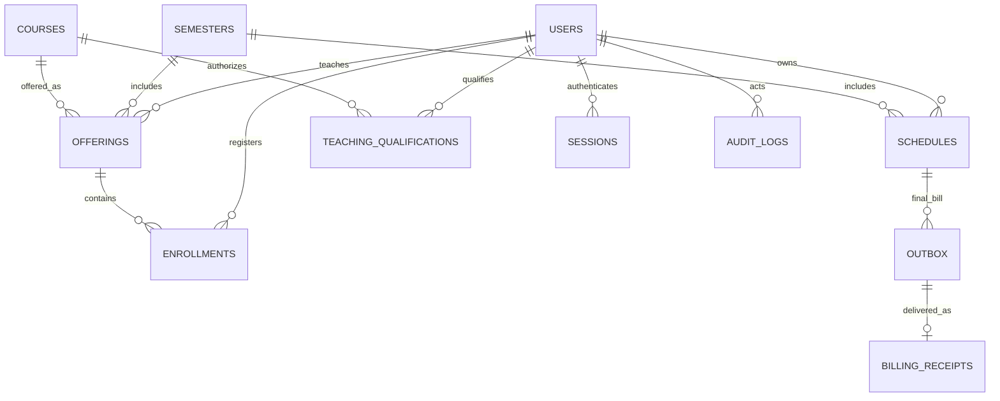
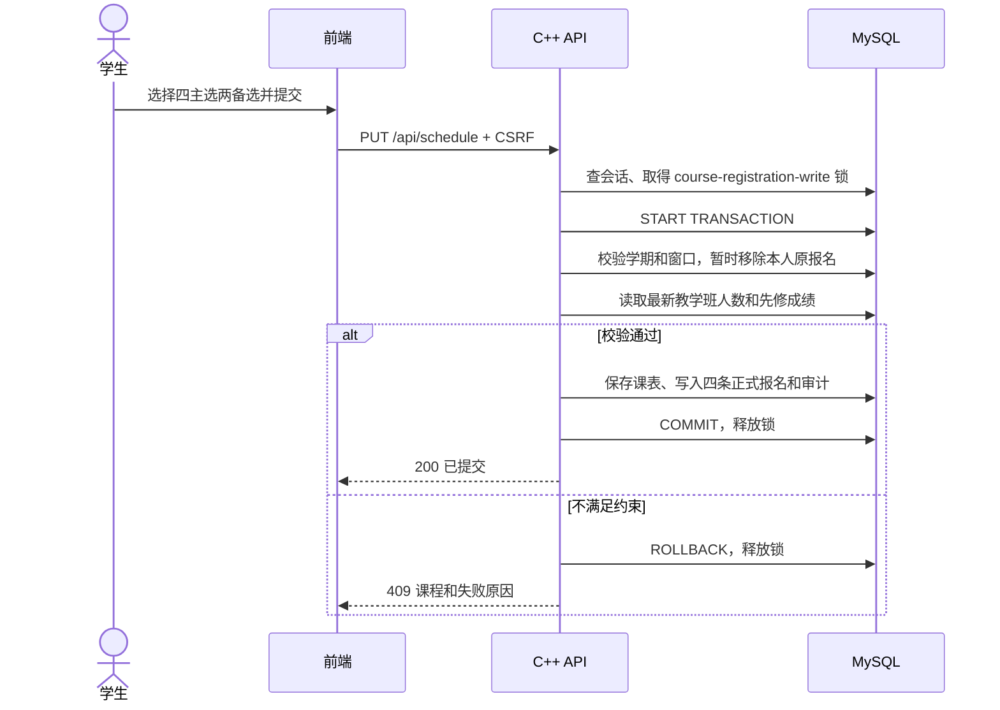

# 系统设计说明书

版本 1.1。本文说明当前系统的架构、数据库、业务算法和接口保护机制。

## 1. 架构

采用浏览器/服务器架构。C++17 HTTP 服务同时提供静态页面和 REST JSON 接口，避免跨域部署带来的额外配置。MySQL 8.4 保存业务数据和演示目录；HTTP 后台线程负责可靠通知财务。

外部遗留 Ingres 和真实财务服务没有提供，因此当前两个外部系统均使用演示适配。用 Docker 部署时数据库不开放主机端口，网页默认只绑定主机回环地址。

## 2. 代码模块

| 文件 | 职责 |
|---|---|
| `backend/src/main.cpp` | MySQL 客户端初始化、初始密码、HTTP 线程池、静态资源和工作线程 |
| `backend/src/db.cpp` | 连接配置、预处理参数、结果转 JSON、事务与数据库命名锁、加密工具 |
| `backend/include/domain.hpp` | 时间重叠、先修通过、可加入性判断、关闭补位与取消 |
| `backend/src/service.cpp` | API 鉴权、角色授权、输入检查、应用流程、计费重试 |
| `frontend/app.js` | 页面状态、同源请求、课表编辑、角色页面、错误提示与轮询 |
| `database/*.sql` | 模型约束、只读权限和演示数据 |

`Domain` 是设计图中的规则集合，实际实现为 C++ `domain` 命名空间，不虚构不存在的实体类。业务实体通过 MySQL 行和 `json` 数据对象传递。

## 3. 数据库设计

课程目录与应用数据库分离。应用账号对 `legacy_catalog` 只有 SELECT 权限；课程维护不在本系统范围内。

上图同时描述逻辑关联。`outbox`、`audit_logs`、跨库课程和 JSON 内选课 ID 的部分关联由应用维护，不全部等同于物理外键。物理约束以 SQL 为准。

| 表 | 关键字段和约束 | 用途 |
|---|---|---|
| legacy_catalog.courses | id 主键；code 唯一；credits；fee_cents；prerequisites JSON | 只读课程目录 |
| users | id；username 唯一；role；name；birth_date；ssn 唯一；department；graduation_date；password_salt/password_hash；active | 三角色共用账号，只有 STUDENT 需要毕业日期 |
| semesters | id；status；add_drop_start/end | 开放、关闭、已完成学期 |
| teaching_qualifications | professor_id + course_id 联合主键 | 教师授课资格 |
| offerings | id；semester_id；course_id；section；professor_id；day；start/end_slot；room；capacity；status | 一个具体教学班，学期/课程/班号唯一 |
| schedules | student_id + semester_id 主键；primary_choices/alternate_choices/submitted_alternates JSON；status | 草稿/已提交/最终课表，保持备选顺位 |
| enrollments | student_id + offering_id 主键；grade | 正式报名和成绩，唯一约束防重复 |
| sessions | token_hash 主键；user_id；csrf_token；expires_at | 登录会话，原始 Cookie token 不存库 |
| billing_outbox | id 主键；event_key 唯一；student_id；semester_id；amount_cents；payload；status；attempts；next_attempt_at | 与关课同事务写入、异步可靠发送 |
| billing_receipts | event_key 主键；payload；received_at | 演示财务接收记录 |
| audit_logs | actor_id；action；detail；created_at | 保存/提交、成绩、维护与关课审计 |

完整字段类型见 `database/001_schema.sql`。金额保存为整数分；没有浮点求和误差。课程名、姓名等使用 utf8mb4；日期采用 DATE，持久化事件时间用数据库 TIMESTAMP/DATETIME。

## 4. 选课事务

所有报名、授课变更、关课和人员变更在同一 MySQL `GET_LOCK` 下写入；锁跨进程生效，连接异常中断由 MySQL 释放。普通写操作最多等 3 秒，关闭请求等待 0 秒，有进行中的操作就返回 409。`Transaction` 析构函数保证未提交时回滚。

普通读请求不占写锁。当前实现串行化业务写入，以课程规模换取确定性，不能据此宣称满足原题 2000 并发用户指标。后续可按教学班 ID 升序 `SELECT ... FOR UPDATE`，并为关课增加独立屏障；需同时修改所有写路径才能避免绕过锁。

## 5. 补位与取消的具体规则

1. 收集实际有正式报名的课表，以 enrollments 为主选、submitted_alternates 为备选；修改草稿不会撤回上次提交，新建未提交草稿不参与。
2. 标记无教师教学班取消，并从参与课表的主选中移除。
3. 按学生 ID 升序处理。只要主选不足四门，按备选数组顺序尝试。
4. 补入必须满足：教学班仍开放、有教师、人数小于 10、先修课程已通过、与现有主选无时间冲突、不重复同一课程。
5. 每补入一门立刻增加内存中的人数，后续学生看到更新的名额。
6. 补位结束后，最终人数不足 3 的教学班取消；其余关闭并开班。
7. 最后从课表移除取消班级，重建本学期正式报名，写最终课表和学费。

有教师但暂时不足三人的课程保留到步骤 6，允许作为备选补足开班人数。这是对原题 Close Registration 步骤 2—4 的明确解释，需要人工评审核验。

最终取消后不再次循环补选；最终课表可少于四门。先到达算法顺序的学生优先获得备选名额；本实现采用 ID 顺序作为可重复的教学演示规则，不代表真实高校推荐的公平分配政策。

例：学生原主选 A/B/C/D，其中 D 无教师，第一备选 E 有教师、已有两人且无冲突。D 被移除，E 补入后达到三人，最终课表为 A/B/C/E。

## 6. 财务可靠性

关闭注册在一个事务内保存最终课表和 `outbox`，两者要么都成功要么都失败。工作线程每秒轮询待发送消息，HTTP 连接 2 秒、读写各 3 秒超时；失败退避 2、4、8……最多 300 秒，不设置丢弃次数。

幂等 ID 为 `tuition-{semester}-{student}`。财务接收端以此为主键执行幂等插入；同一消息因超时或服务重启再次发送不会重复入账。真实财务系统必须实现同等幂等语义。当前演示 API 可由教务切换“可用/不可用”以执行故障恢复测试。

计费只以最终课表为准；原题背景中的选课完成通知在此解释为关闭后的最终结算，避免选退课过程中重复收费。若需提交时的预通知，需扩展为不同事件类型，不能直接复用最终扣费接口。

## 7. 身份与数据保护

密码采用 OpenSSL PBKDF2-HMAC-SHA256、随机 16 字节盐、210000 次迭代、32 字节输出；对比使用常量时间函数。会话为 32 字节随机数，库内保存 SHA-256，Cookie 使用 HttpOnly、SameSite=Strict。写请求另校验会话内 CSRF 令牌。

API 只按会话角色和所有权决定操作范围，不信任浏览器传入的用户角色。数据库交互统一预处理参数；前端显示变量统一转义；CSP 只允许同源脚本和样式。角色前端页面并不能替代服务端检查。

初始化密码仅在首次运行时生成。当前缺少用户自助改密、会话定期清理、敏感身份字段加密和管理员会话审计查询界面；真实部署前需补充。演示身份字段全部为 `DEMO-*`。

## 8. 前端设计

单页界面按角色显示导航，宽屏为侧栏+工作区，窄屏改为顶部横向导航。课程卡显示代码、名称、教师、时间、学费、先修和人数。底部选择栏显示主选/备选数量及未保存状态。

选课浏览期间每 15 秒刷新人数；变满时提示。网络状态不是名额锁定，最终必须以服务端提交校验为准。错误消息显示在表单或通知中；删除课表、删除人员、关闭选课均使用明确说明的确认对话框。
